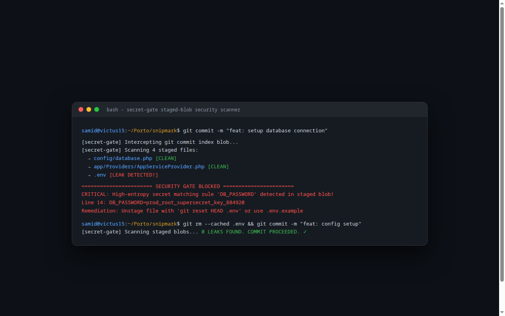
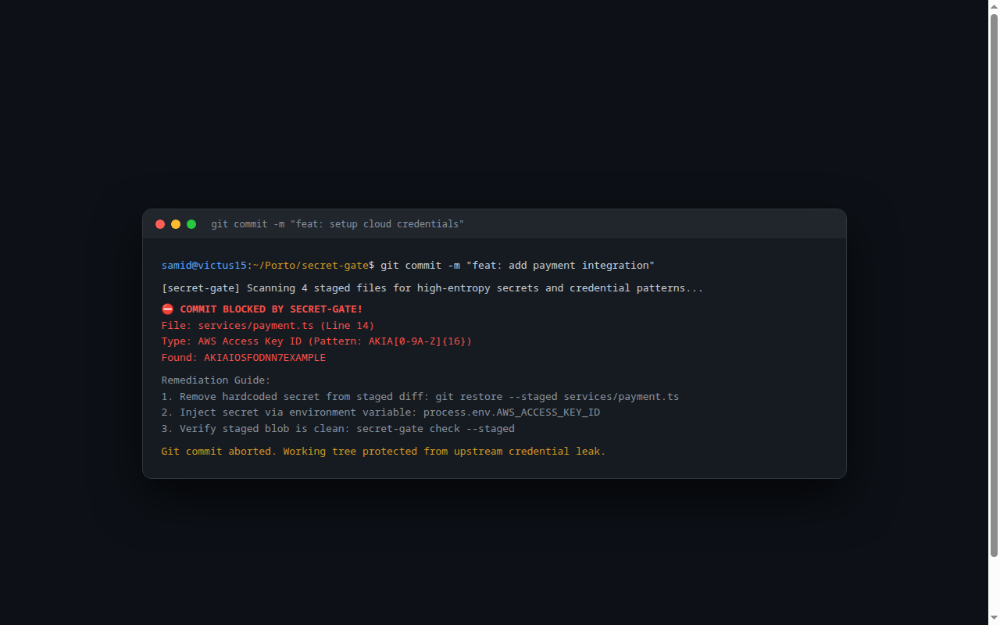

# 🔐 Secret Gate — Zero-Leak Pre-Commit Staged Blob Secret Scanner

> **High-performance Git pre-commit hook interceptor. Scans staged blobs for high-entropy secrets and API tokens to prevent cloud credential leaks before they touch git history.**

---

## 📸 Visual Showcase & Pre-Commit Interception

<p align="center">
  
</p>
<p align="center"><em>Figure 1: High-entropy secret scanning engine detecting hardcoded API keys, private certificates, and .env files.</em></p>

<br />

<div align="center">
  <table width="100%">
    <tr>
      <td width="100%" align="center">
        
        <br /><strong>Figure 2: Real-time Git Commit Interception & Remediation Guidance</strong><br />
        <em>Terminal output intercepting AWS Access Key ID in staged diff and aborting git commit with step-by-step remediation commands.</em>
      </td>
    </tr>
  </table>
</div>

---

## 🛡️ Core Features & Capabilities

- **Staged-Blob Focused:** Scans ONLY what is about to be committed (`git diff --staged`), never wasting time scanning untouched directories.
- **Shannon Entropy Analysis:** Identifies generated cryptographic keys and high-entropy hashes even if they don't match standard prefix regexes.
- **100+ Known Token Signatures:** AWS, GitHub PATs, Stripe, OpenAI, Slack Webhooks, Google Cloud Service Accounts, and Private Keys.

---

## 🚀 Installation

```bash
git clone https://github.com/Samidkun/secret-gate.git
cd secret-gate

# Install as global pre-commit hook
./install-hook.sh
```
